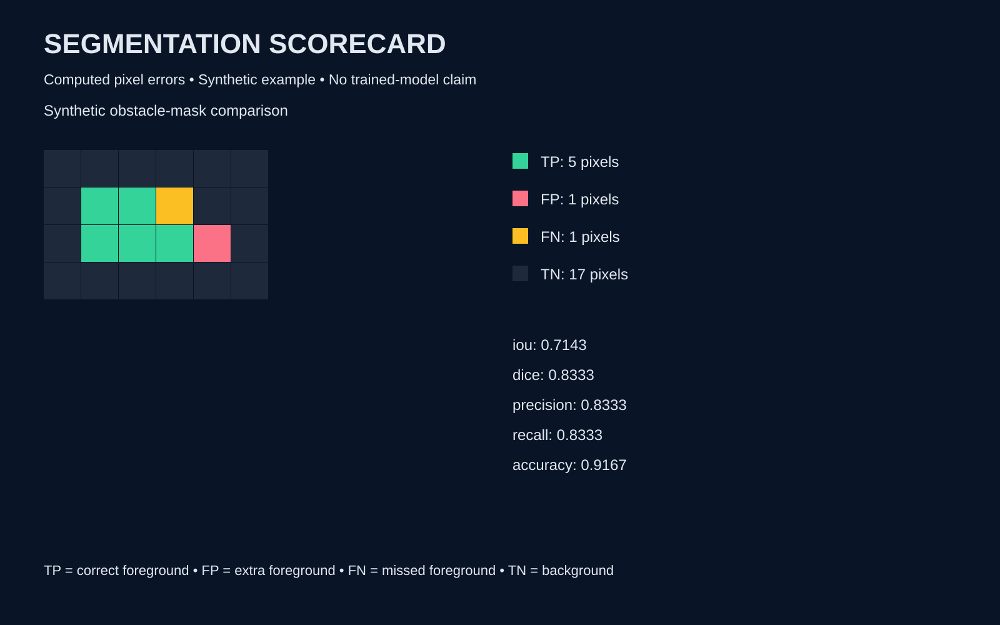

# Segmentation Scorecard

Offline Python computer-vision evaluation for **supplied binary reference and prediction masks**. Learn how false positives, false negatives and aggregation choices affect segmentation assessment before working on robot perception.



## Complete workflow

Validate named mask pairs → compute per-case confusion maps and metrics → aggregate micro/macro scores → export JSON, high-resolution SVGs and a local HTML gallery. No model downloads, inference, telemetry or external dependencies.

## Setup and run

Python 3.10+; standard library only. From the repository directory:

```sh
python scorecard.py sample.json --out evaluation
python -B -m unittest -v
```

Open `evaluation/index.html` in a browser. Existing output directories are refused to protect earlier reports. Invalid input exits with status 2. The tool accepts at most 100 cases, 65,536 pixels per mask and 2 MB per input file. Only integer 0/1 accepted, not booleans; equal reference/prediction dimensions required.

```json
{"cases":[{"name":"example","reference":[[1,0]],"prediction":[[1,1]]}]}
```

Names must be unique nonempty strings, up to 80 characters. No file paths are constructed from user-provided names; HTML/SVG labels are escaped.

## Metrics and honest edge cases

Foreground is the positive class. TP = correct foreground; FP = extra foreground; FN = missed foreground; TN = correctly rejected background.

| Metric | Formula |
| --- | --- |
| IoU / Jaccard | TP / (TP + FP + FN) |
| Dice / foreground F1 | 2TP / (2TP + FP + FN) |
| Precision | TP / (TP + FP) |
| Recall | TP / (TP + FN) |
| Pixel accuracy | (TP + TN) / all pixels |

A zero denominator yields `null`, **not an automatic perfect score**. Macro means exclude undefined cases and report their defined-case count. Micro scores pool pixel counts, weighting large images more heavily. Macro scores average defined image scores equally. Background-heavy masks can make accuracy misleading; overlap scores do not measure calibration or robot safety.

Original synthetic example: TP 5, FP 1, FN 1, TN 17; IoU 5/7 and Dice 5/6. The second all-background case has undefined IoU, precision and recall; accuracy 1. These are fixture computations, not trained-model results.

## Architecture and visuals

- `scorecard.py`: validation, comparison, aggregation, report generation and CLI.
- `test_scorecard.py`: correctness, empty foreground, invalid data, aggregation, escaping and output protection.
- `sample.json`: original synthetic data, no third-party datasets.
- `report.json`, `case-001.svg`, `case-002.svg`, `index.html`: executed demo outputs published at the root; regenerate into a new directory.
- SVGs are computed 1600×1000 confusion diagrams, not camera screenshots or experiments.

## Scope and limitations

Binary masks only; no RGB loading, soft probabilities, threshold tuning, multiclass labels, ignore regions or boundary metrics. Pixel comparisons assume masks are already spatially aligned. No physical robot testing or research benchmark claims. A next step is explicit ignore-mask support with separate valid-pixel accounting.

## Verification, sources and license

See [VERIFICATION.md](VERIFICATION.md). Jaccard/F1 definitions checked against [scikit-learn's primary metrics documentation](https://scikit-learn.org/stable/modules/model_evaluation.html#jaccard-similarity-score); scikit-learn is not a runtime dependency. Null handling is this tool's documented policy.

AI-assisted portfolio implementation for Sadia Liaqat. Original synthetic fixtures and computed visuals; MIT license. Learning-focused computer vision / robot-perception evaluation, not production autonomy.
